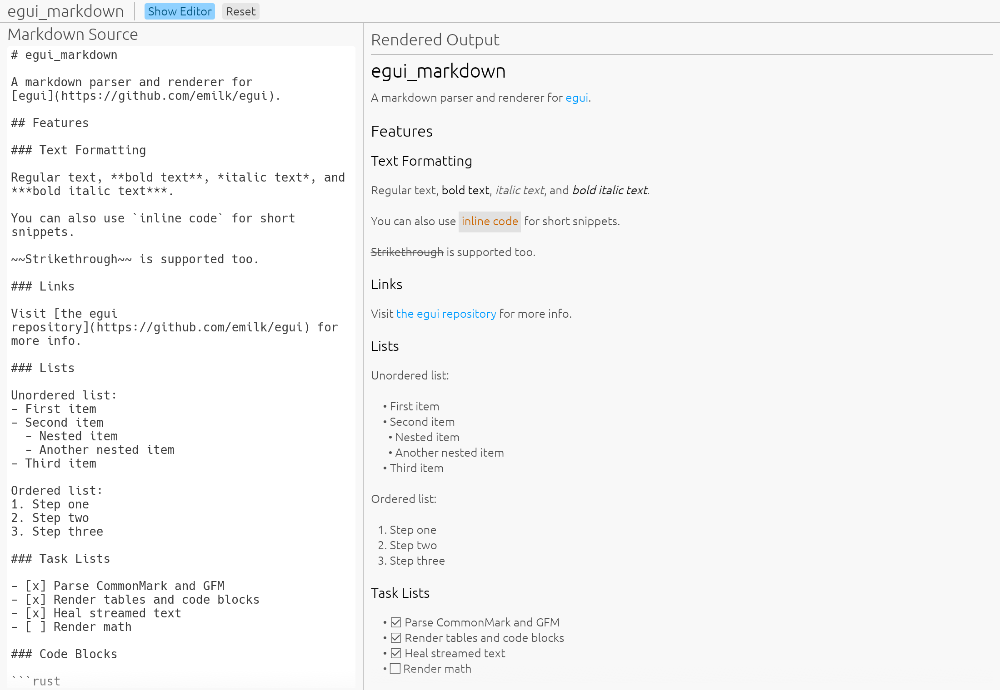
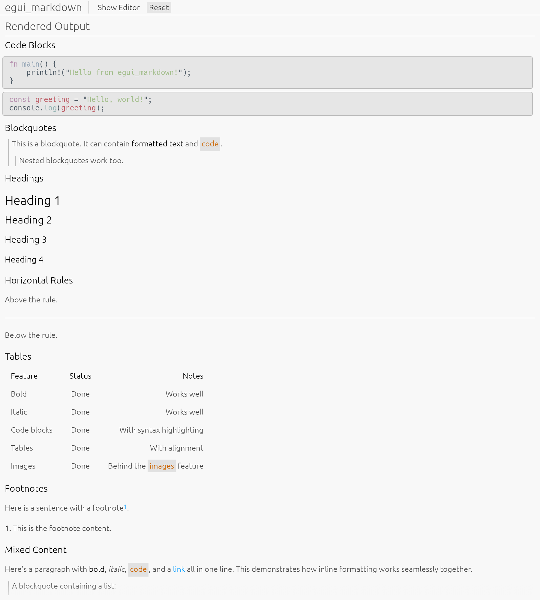

# egui_markdown

[](https://crates.io/crates/egui_markdown)
[](https://docs.rs/egui_markdown)
[](https://github.com/membrane-io/egui_markdown#license)


A markdown parser and renderer for [egui](https://github.com/emilk/egui).

It parses [CommonMark](https://commonmark.org/) markdown into a token stream. It then
renders that stream as one interactive egui widget, with selectable text, clickable links,
syntax-highlighted code blocks, tables, images, blockquotes, and lists.

[ECOSYSTEM.md](ECOSYSTEM.md) compares `egui_markdown` with `egui_commonmark`, and lists other Rust
markdown crates.

<picture>
  <source media="(prefers-color-scheme: dark)" srcset="docs/screenshots/simple-dark.png">
  
</picture>

## Quick Start

```rust
use eframe::egui;
use egui_markdown::MarkdownLabel;

fn show_markdown(ui: &mut egui::Ui) {
    let text = "# Hello\n\nThis is **bold** and *italic*.";
    MarkdownLabel::new(ui.make_persistent_id("md"), text).show(ui);
}
```

## Supported Markdown

**CommonMark** - headings (H1-H6), paragraphs, bold, italic, strikethrough,
inline code, fenced code blocks, links, images, blockquotes (nested), ordered
and unordered lists (nested), horizontal rules.

**GitHub Flavored Markdown** - tables (with column alignment), task lists,
footnotes.

**HTML** - the label renders the `` and `<br>` tags, and it shows each other tag as written.

## Features

- **Text selection** - rendered markdown is selectable in the same way as normal egui text.
- **Scrollable code blocks** - with `.scroll_code_blocks(true)`, a long line scrolls horizontally and does not wrap.
- **Code block overlays** - a callback attaches buttons, such as a copy button or a language badge, to a code block.
- **Syntax highlighting** - highlighting through `syntect`, with built-in base16-ocean dark and light themes, and support for custom themes.
- **Custom link handlers** - the `LinkHandler` trait lets you style links, respond to clicks, and override the layout. It can also render a link as an inline or block-level widget.
- **Streaming and heal mode** - `.heal(true)` closes unclosed code fences, bold, italic, links, and tables, so that partial LLM output renders correctly.
- **Configurable style** - `MarkdownStyle` controls the inline code colors, and the code block padding, stroke, font size, and default language. It also controls the heading scales, the horizontal rule stroke and height, the blockquote indent and bar width, the list marker positions and bullet size, the table stroke, corner radius, and cell padding, and the block spacing. Inline code and code blocks take their corner radius from `egui::Visuals::code`, and inline code also takes its margin and border from it. `MarkdownStyle::ui()` gives a built-in interactive editor.
- **Bold font family** - uses a registered `"bold"` font family when one exists, and the strong text color when none exists.
- **Code font styles** - a code block shows the italic, bold and underline that the syntect theme gives a scope. Bold uses a registered `"mono-bold"` font family. Without one, bold code keeps the regular monospace family.
- **Layout caching and viewport culling** - layout caching based on a hash, with viewport culling per segment, for smooth scrolling through large documents.

## Feature Flags

| Feature | Default | Description |
|---------|---------|-------------|
| `syntax_highlighting` | Yes | Syntax-highlighted code blocks through `syntect`. Without it, code blocks use the small built-in highlighter of `egui_extras`, which knows fewer languages. |
| `extra_syntaxes` | No | The syntaxes of `bat` through `two-face`, with TypeScript, TSX and JSX. It makes the binary larger. |
| `images` | No | Image rendering through the `egui_extras` image loaders. Call `egui_extras::install_image_loaders(ctx)` once at startup. The feature also turns on the HTTP loader, so an image URL can be remote. |
| `svg` | No | SVG image support through `egui_extras`. |

### egui version

egui_markdown needs egui `main` until the next egui release, for APIs that egui 0.37.0 does not have,
such as `Visuals::code` and `LayoutSection::wrap_indent`. It also needs Rust 1.95. Patch egui to `main`
in your workspace:

```toml
[patch.crates-io]
egui = { git = "https://github.com/emilk/egui.git", branch = "main" }
epaint = { git = "https://github.com/emilk/egui.git", branch = "main" }
egui_extras = { git = "https://github.com/emilk/egui.git", branch = "main" }
emath = { git = "https://github.com/emilk/egui.git", branch = "main" }
ecolor = { git = "https://github.com/emilk/egui.git", branch = "main" }
```

Patch `emath` and `ecolor` even when you do not depend on them directly. Without those two
entries the build has two incompatible copies of the types that egui shares between crates.
Add `eframe` as well when you use it.

## Customization

### `MarkdownStyle`

Use [`MarkdownStyle`](https://docs.rs/egui_markdown/latest/egui_markdown/struct.MarkdownStyle.html) to control the appearance of every markdown element.

```rust
use egui_markdown::{MarkdownLabel, MarkdownStyle};

let mut style = MarkdownStyle::default();
style.heading.scales[0] = 2.0; // Bigger H1
style.code_font_size = Some(14.0); // `None` uses egui's monospace size
MarkdownLabel::new(id, text).style(&style).show(ui);
```

`MarkdownStyle` also has a `ui()` method that renders an interactive editor for every
style field. See the `style` example.

To give every label in an app the same style, install it once on the context. A label with no
`.style()` reads it:

```rust
egui_markdown::set_style(ctx, MarkdownStyle { code_font_size: Some(14.0), ..Default::default() });
```

### `LinkHandler`

Implement the [`LinkHandler`](https://docs.rs/egui_markdown/latest/egui_markdown/trait.LinkHandler.html) trait
to customize the style of a link, the tooltip, the response to a click, and the rendering.
Implement `inline_widget_size()` and `paint_inline_widget()` to render a link as an inline widget,
such as a user mention or a status badge. Implement `is_block_widget()` and `block_widget()` to
render a link as a block-level widget, such as an embed or a card.

### Code Themes

Pass a custom `syntect::highlighting::Theme` to `.code_theme()` to override the
built-in base16-ocean theme for one label. `set_code_themes(ctx, dark, light)` installs a pair
of themes for every label in the context, and each label picks the one for the current
dark-mode setting.

### Streaming

Enable `.heal(true)` on `MarkdownLabel` to close unclosed code fences and inline constructs
before the parse. Without this, the parser treats the text that follows an unclosed
construct as part of that construct. Use it for streaming LLM output, and turn it off when the
reply is complete.

Keep the widget id the same while the text grows. The caches live under that id, so an id
that changes with the text lays out the whole document again on every delta.

`.map_job()` rewrites the layout just before it is shaped, for example to fade in the newest
text. A map that hides the end of the text makes the label allocate only the rows that show.

### Wrapping

A label wraps the way the surrounding `Ui` does, and `.wrap()`, `.truncate()` and `.extend()`
override that, as on `egui::Label`. `.truncate().max_lines(3)` elides after three rows.
`.overflow_wrap(OverflowWrap::BreakAll)` breaks a run that is wider than the label, such as a
long URL, between any two characters.

### Code blocks

`.code_block_buttons(f)` calls `f(ui, code, language)` to add buttons over each code block, for
example a copy button. `.scroll_code_blocks(true)` makes each code block a separate widget that
scrolls horizontally. With scrolling code blocks, `.shrink_code_blocks(true)` makes a code block as
wide as its content, and `.code_block_min_width()` sets the smallest width of a shrunk code block.

### Size

`.hug_content(true)` makes the label as wide as its content, not as wide as the available space.
`calculate_size()` measures the label in an invisible child `Ui`. `layout_in_ui()` lays out the
text as one galley, and the caller paints it. That galley leaves out tables, images, block widgets
and scrolling code blocks.

### Clicks

`show()` returns a `MarkdownLabelOutput`. Its `response` covers all of the label, and it is clicked
when the click is on the text. `link_clicked` is true when the click was on a link, which the label
has already handled. A parent that reacts to a click on the label checks both:

```rust
let output = MarkdownLabel::new(id, text).show(ui);
if output.response.clicked() && !output.link_clicked {
    select_message();
}
```

## Examples

<picture>
  <source media="(prefers-color-scheme: dark)" srcset="docs/screenshots/lower-dark.png">
  
</picture>

| Example | Description |
|---------|-------------|
| `hello_world` | One label in a scroll area. Start here. |
| `editor` | A text editor and the rendered output. |
| `streaming` | Text that arrives a few characters at a time. The label heals the text while it is incomplete, and `.map_job()` fades in the newest characters. |
| `links` | A `LinkHandler`: link colors, tooltips, clicks, an inline widget and a block widget. |
| `code_blocks` | A Copy button on each code block, horizontal scrolling, and a dark and a light syntect theme. |
| `style` | The `MarkdownStyle` editor, `set_style`, and the theme buttons. |
| `images` | Images from URLs. It needs the `images` feature. |

```sh
cargo run --example hello_world
cargo run --example images --features images
```

## License

MIT or Apache-2.0
