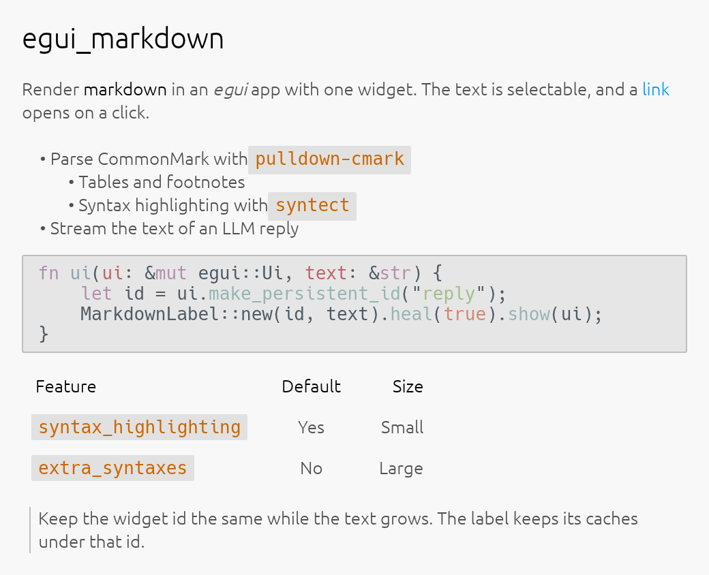

# egui_markdown

[](https://crates.io/crates/egui_markdown)
[](https://docs.rs/egui_markdown)
[](https://github.com/membrane-io/egui_markdown#license)


A markdown parser and renderer for [egui](https://github.com/emilk/egui).
It renders [CommonMark](https://commonmark.org/) and GitHub tables, task lists and footnotes as one
egui widget with selectable text.

<picture>
  <source media="(prefers-color-scheme: dark)" srcset="https://raw.githubusercontent.com/membrane-io/egui_markdown/main/docs/screenshots/readme-dark.png">
  
</picture>

## Usage

```toml
egui_markdown = "0.1"
```

```rust
use eframe::egui;
use egui_markdown::MarkdownLabel;

fn show_markdown(ui: &mut egui::Ui) {
    let text = "# Hello\n\nThis is **bold** and *italic*.";
    MarkdownLabel::new(ui.make_persistent_id("md"), text).show(ui);
}
```

## Features

- Text selection, as on `egui::Label`.
- Syntax highlighting through `syntect`, with custom themes.
- Tables with column alignment, and images with the `images` feature.
- `LinkHandler` changes the style, the tooltip and the click of a link, and can show a link as a
  widget.
- `.heal(true)` closes unclosed constructs, so partial LLM output renders correctly while it
  streams.
- `MarkdownStyle` controls the look of each element, and has a built-in editor.
- Layout caches and viewport culling keep large documents fast.

The [crate docs](https://docs.rs/egui_markdown) describe each option.
[ECOSYSTEM.md](ECOSYSTEM.md) compares `egui_markdown` with other Rust markdown crates.

## Feature flags

| Feature | Default | Description |
|---------|---------|-------------|
| `syntax_highlighting` | Yes | Syntax-highlighted code blocks through `syntect`. Without it, code blocks use the small built-in highlighter of `egui_extras`, which knows fewer languages. |
| `extra_syntaxes` | No | The syntaxes of `bat` through `two-face`, with TypeScript, TSX and JSX. It makes the binary larger. |
| `images` | No | Image rendering through the `egui_extras` image loaders. Call `egui_extras::install_image_loaders(ctx)` once at startup. The feature also turns on the HTTP loader, so an image URL can be remote. |
| `svg` | No | SVG image support through `egui_extras`. |

## egui version

egui_markdown needs egui `main` and Rust 1.95 until the next egui release. Patch egui in your
workspace:

```toml
[patch.crates-io]
egui = { git = "https://github.com/emilk/egui.git", branch = "main" }
epaint = { git = "https://github.com/emilk/egui.git", branch = "main" }
egui_extras = { git = "https://github.com/emilk/egui.git", branch = "main" }
emath = { git = "https://github.com/emilk/egui.git", branch = "main" }
ecolor = { git = "https://github.com/emilk/egui.git", branch = "main" }
```

Patch `emath` and `ecolor` too, or the build has two incompatible copies of their types. Add
`eframe` when you use it.

## Examples

```sh
cargo run --example hello_world  # One label in a scroll area. Start here.
cargo run --example editor       # A text editor and the rendered output.
cargo run --example streaming    # Text that arrives a few characters at a time.
cargo run --example links        # A LinkHandler with tooltips, clicks and widgets.
cargo run --example code_blocks  # Copy buttons, horizontal scrolling and syntect themes.
cargo run --example style        # The MarkdownStyle editor.
cargo run --example images --features images  # Images from URLs.
```

## License

MIT or Apache-2.0
